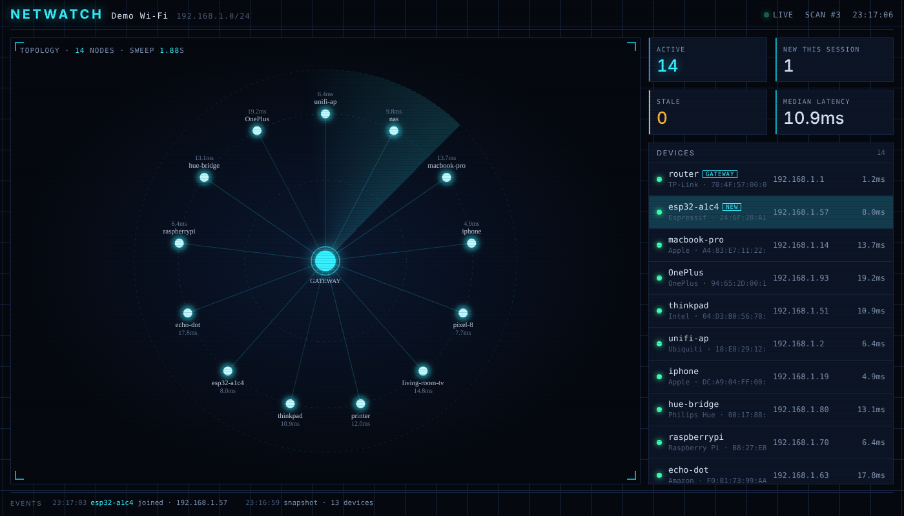

# Netwatch

**A real-time, radar-style dashboard of every device on your local network.**

Netwatch sweeps your LAN with ARP every few seconds, streams the results to your browser over a WebSocket, and draws each device as a glowing node orbiting your router. Devices light up when they answer, fade to amber when they go quiet, and drop off when they leave. It runs entirely on your machine; nothing is sent anywhere.



[](LICENSE)
[](https://www.python.org/)
[](#platform-notes)

## Features

- **Live topology** — your gateway at the centre, every device on a ring around it. Each ARP reply sends a particle down the link and brightens the node.
- **Join / leave / return events** — a ticker at the bottom logs every change with a timestamp; new devices flash in the table and carry a `NEW` badge for a minute.
- **Device detail** — IP, MAC, vendor (from the IEEE OUI registry), hostname when available, round-trip latency, and last-seen time. Hover a node for a tooltip; click to pin it.
- **Status at a glance** — active / new-this-session / stale / median latency tiles, plus your Wi-Fi name and subnet in the header.
- **VPN-aware** — picks your physical Wi-Fi or Ethernet interface and ignores VPN tunnels, so it scans the room you're in, not the office you're tunnelled into.
- **No build step** — one Python file and one HTML file. No Node, no bundler, no database.
- **Demo mode** — run it with simulated devices to see it work before granting scan privileges.

## Quick start

```bash
git clone https://github.com/gipsbrian/netwatch.git
cd netwatch
python3 -m venv .venv && source .venv/bin/activate      # Windows: .venv\Scripts\activate
pip install -r requirements.txt
```

Try it with simulated devices first (no privileges needed):

```bash
python server.py --demo
```

Then scan your real network. Raw ARP sockets need root/admin:

```bash
sudo .venv/bin/python server.py          # macOS / Linux
```

Open **http://localhost:8008**. The terminal prints the network it chose, and devices appear after the first sweep (about 10 seconds).

On first run Netwatch downloads the IEEE vendor list once (~2 MB) so MAC addresses resolve to names like Apple, Samsung or Espressif.

## Options

| Flag | Default | Purpose |
|---|---|---|
| `--demo` | off | Simulated devices, no root needed |
| `--port N` | `8008` | Port for the dashboard |
| `--iface NAME` | auto | Interface to scan on, e.g. `en0`, `eth0`, `wlan0`. Auto-detection skips VPN tunnels |
| `--subnet CIDR` | auto | Range to sweep, e.g. `192.168.0.0/24`, if auto-detection picks wrong |

Timing constants live at the top of `server.py`:

| Constant | Default | Meaning |
|---|---|---|
| `SCAN_INTERVAL` | 10 s | Seconds between ARP sweeps |
| `STALE_AFTER` | 45 s | No reply for this long → device shown as stale (amber, outer ring) |
| `GONE_AFTER` | 180 s | No reply for this long → device removed |

## Platform notes

**macOS** — Works out of the box on macOS 12+. Run with `sudo`. The Wi-Fi name is read with `ipconfig getsummary` (the old `airport` tool was removed in Sonoma). If you're on a VPN the auto-detection still picks your physical interface; if it doesn't, pass `--iface en0`.

**Linux** — Run with `sudo` (or grant `CAP_NET_RAW` to the venv's Python with `setcap`). Wi-Fi name comes from `iwgetid` or `nmcli` when either is installed.

**Windows** — Install [Npcap](https://npcap.com) (tick "WinPcap API-compatible mode"), then run `python server.py` from an Administrator terminal. Wi-Fi name comes from `netsh wlan show interfaces`.

## How it works

```
┌────────────┐   ARP who-has     ┌────────────┐
│ server.py  │ ───────────────▶  │   LAN      │
│  scapy     │ ◀───────────────  │  devices   │
└─────┬──────┘   ARP is-at       └────────────┘
      │ joined / updated / left (JSON over WebSocket)
      ▼
┌────────────┐
│ index.html │  canvas topology · device table · event ticker
└────────────┘
```

1. **Discovery** — `arp_scan_loop` broadcasts an ARP request for every address in the subnet using [scapy](https://scapy.net) and records each reply: MAC, IP, and round-trip time. ARP works below IP, so it finds devices that ignore ping.
2. **Enrichment** — each new MAC is looked up in the IEEE OUI registry (`mac-vendor-lookup`, with a small built-in table as an offline fallback) and reverse-DNS is attempted for a hostname.
3. **State** — `DeviceTable` keeps every device in memory, ages them into *stale* and then *gone*, and broadcasts a diff (`joined`, `updated`, `left`, `scan`) to every connected WebSocket client. Nothing is persisted between runs.
4. **Rendering** — `static/index.html` keeps a mirror of the table, lays nodes out on a ring ordered by IP so they never jostle, and animates glow, particles and the radar sweep on a `<canvas>`. If the page can't reach the server it falls back to a built-in simulation, which is what powers `--demo` previews and the hosted demo.

### API

| Endpoint | Description |
|---|---|
| `GET /` | The dashboard |
| `GET /api/devices` | JSON snapshot: `{gateway, network, scan, devices: [...]}` |
| `WS /ws` | Snapshot on connect, then a stream of `joined` / `updated` / `left` / `scan` events |

Each device object looks like:

```json
{
  "mac": "A4:83:E7:11:22:01",
  "ip": "192.168.1.14",
  "hostname": "macbook-pro",
  "vendor": "Apple",
  "first_seen": 1792525595.98,
  "last_seen": 1792525599.98,
  "latency": 10.3,
  "status": "active",
  "is_gateway": false,
  "history": [11.8, 10.3]
}
```

## Troubleshooting

**The subnet shown is `10.8.x.x` or `100.x.x.x` and nothing appears** — that's a VPN or Tailscale range. Auto-detection should skip it; if it doesn't, run with `--iface en0` (macOS) or `--iface wlan0` (Linux).

**Only the router shows up** — your network has client isolation turned on (common on guest and hotel Wi-Fi). Devices can't see each other at the ARP level, so there's nothing to discover.

**Phones keep flickering stale** — iOS and Android sleep their Wi-Fi radio aggressively and sometimes miss an ARP request. Raise `STALE_AFTER` to 90 s if it bothers you.

**Every vendor is "Unknown"** — the one-time vendor download failed (no internet at first run). Delete `~/.cache/mac-vendors.txt` and restart with internet, or just run again; it retries on each start.

**`PermissionError` / "Operation not permitted"** — ARP needs raw sockets. Use `sudo`, or on Linux: `sudo setcap cap_net_raw+ep .venv/bin/python3`.

## Roadmap

- Passive mode: sniff ARP, DHCP and mDNS so devices appear the instant they speak
- mDNS/Bonjour hostnames ("Brian's iPhone" instead of "Apple")
- SQLite history with first-seen / last-seen and a 24-hour view
- Desktop notification or webhook when an unknown MAC joins
- Per-device nicknames and icons

Contributions welcome — see [CONTRIBUTING.md](CONTRIBUTING.md).

## License

[MIT](LICENSE) © 2026 gipsbrian
